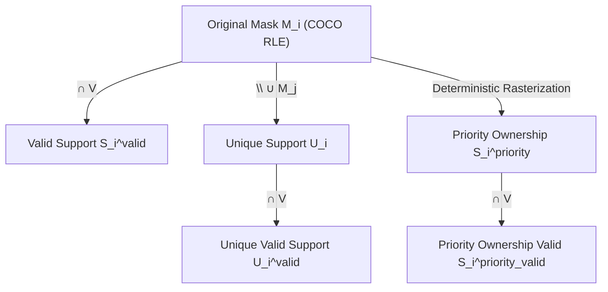

# TreeFlowNet Reference Semantics V3

**Version:** 3.0.0  
**Effective Date:** 2026-10-15  
**Scope:** Mathematical formulation of ground-truth instances, support partitions, ownership rasters, and area conventions.

---

## 1. Formal Ground-Truth Support Definitions

Let an aerial image tile have spatial domain $\Omega = \{0, \dots, H-1\} \times \{0, \dots, W-1\} \subset \mathbb{Z}^2$.  
Let $V \subseteq \Omega$ be the binary valid support indicator ($V(p) = 1$ if pixel $p$ is within the valid survey area, $0$ otherwise).  
Let $\mathcal{M} = \{M_1, M_2, \dots, M_K\}$ denote the set of $K$ ground-truth tree crown instance masks on the tile, where each $M_i \subseteq \Omega$ is a binary mask decoded from the authoritative COCO RLE representation.

### 1.1. Original Support
$$M_i = \{p \in \Omega \mid \text{RLE}_i(p) = 1\}$$
- **Semantic Meaning:** The complete unclipped polygon traced by the annotator. Can overlap with neighboring crowns ($M_i \cap M_j \ne \emptyset$).
- **Role:** Authoritative reference for end-to-end instance segmentation evaluation (COCO AP, Cardinality-First IoU).

### 1.2. Valid Support
$$S_i^{valid} = M_i \cap V$$
- **Semantic Meaning:** The portion of crown $i$ resting on verified imagery ground data.
- **Role:** Reference for support-bounded evaluations. In QuebecTrees, 29 train annotations and 6 validation annotations have pixels extending outside $V$ into the nodata collar; $S_i^{valid}$ bounds the evaluation to the valid mosaic.

### 1.3. Unique Original Support
$$U_i = M_i \setminus \bigcup_{j \ne i} M_j$$
- **Semantic Meaning:** The subset of pixels in crown $i$ that belong exclusively to crown $i$ and to no other annotated tree.
- **Empirical Note:** In dense canopies, $U_i$ can be significantly smaller than $M_i$. In the train set, 63 annotations have $U_i = \emptyset$ (completely occluded or sub-canopy crowns).

### 1.4. Unique Valid Support
$$U_i^{valid} = U_i \cap V = \left(M_i \setminus \bigcup_{j \ne i} M_j\right) \cap V$$
- **Semantic Meaning:** Exclusively owned pixels within the valid survey boundary.
- **Role:** Required anchor domain for point-based structural grouping evaluation to prevent ambiguous multi-owner anchor sampling.

### 1.5. Priority Ownership Raster
Let $L: \Omega \to \{0, 1, \dots, K\}$ be a single-channel label raster, where $0$ represents background and $k \in \{1, \dots, K\}$ is the assigned instance index.
$$S_i^{priority} = \{p \in \Omega \mid L(p) = i\}$$

**Conflict-Resolution Policy for Priority Ownership:**
When two or more original masks overlap at pixel $p$ ($\exists i \ne j$ such that $p \in M_i \cap M_j$), the conflict MUST be resolved by a declared, deterministic policy:
1. **Area-Ascending Priority (Default for Canopy Flow)**:
   $$L(p) = \arg\min_{i \in \{k \mid p \in M_k\}} |M_i|$$
   *Rationale:* Smaller crowns are given higher painting priority so that small sub-canopy or interior crowns are not completely obliterated by large canopy crowns.
2. **Index-Descending Priority (Legacy Diagnostic)**:
   $$L(p) = \max \{k \mid p \in M_k\}$$
   *Rationale:* Reproduces legacy painter's algorithm order where higher annotation index overwrites earlier ones.

### 1.6. Priority Ownership Valid
$$S_i^{priority\_valid} = S_i^{priority} \cap V$$
- **Role:** Evaluation of dense pixel-level field decoders (e.g., flow field targets, distance-to-boundary rasters).

---

## 2. Fundamental Non-Conflation Invariants

The infrastructure enforces three automated invariants:
1. **No Silent Erasure:** Primary instance matching (AP, Recall) MUST evaluate candidate proposals against $M_i$ (or $S_i^{valid}$), NEVER against $S_i^{priority}$. Evaluating against $S_i^{priority}$ silently erases crowns with empty priority support.
2. **Anchor Eligibility Rule:** Grouping anchors must be sampled strictly from $U_i^{valid}$ with boundary erosion $D \ge r$ to ensure topological uniqueness.
3. **Traceability:** Every derived raster mask must store a link back to its originating COCO `annotation_id`.

---

## 3. Explicit Area Formula and Size Binning

For any mask $M$, its canonical physical ground area is defined as:
$$A(M) = N(M) \cdot \Delta A_{px}$$
where $N(M) = \sum_{p \in \Omega} M(p)$ is the discrete pixel count and $\Delta A_{px} = |\det(A)|$ is the affine ground area per pixel ($0.0009\text{ m}^2$ for $0.03\text{ m}$ GSD).

Native COCO `area` floats are retained in parallel as `metadata_area` for lineage verification. Any comparison between methods must evaluate size strata based exclusively on $A(M)$.
